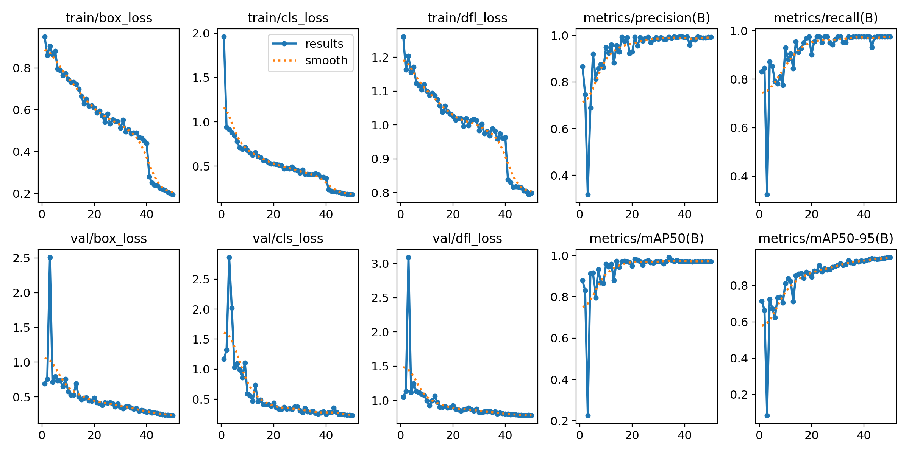
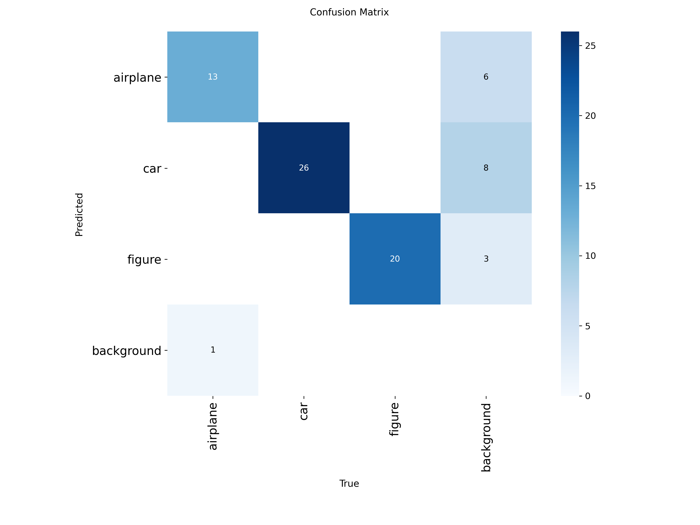
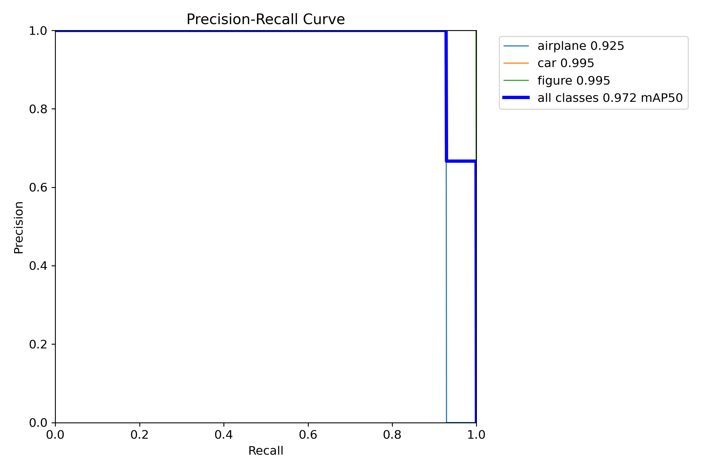
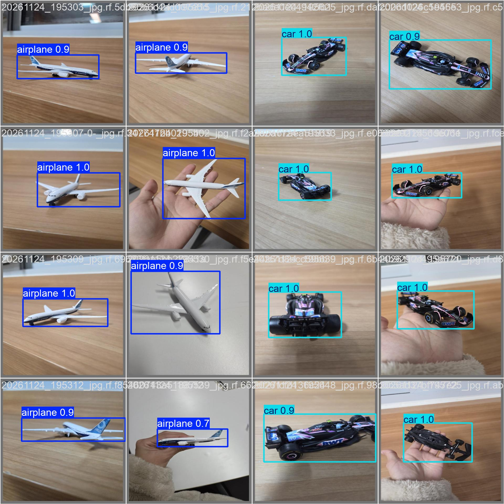

# YOLOv8 장난감 객체 탐지 및 추적

장난감 3종(비행기, 자동차, 피규어)을 직접 촬영해 데이터셋을 만들고, COCO로 사전학습된 YOLOv8n을 fine-tuning했다. 학습한 모델로 동영상에서 객체 탐지와 추적을 수행했다.

## 부류

| 부류 | 대상 |
|---|---|
| airplane | 비행기 모형 |
| car | F1 자동차 모형 |
| figure | 캐릭터 피규어 |

## 데이터

- 휴대폰으로 직접 촬영한 사진 226장
- 라벨링: Roboflow (Auto Label 후 틀린 박스 수정, 못 잡은 것은 직접 박스 그림)
- 분할: train 70% / valid 20% / test 10%
- 전처리: Auto-Orient, 640x640 Resize
- 증강: Horizontal Flip, Brightness (train만 3배)
- 최종 이미지 수: train 472 / valid 45 / test 23

## 학습

- 모델: yolov8n.pt (COCO 사전학습)
- epochs 50, imgsz 640, batch 16
- 환경: Google Colab, Tesla T4
- 학습 시간: 약 6분

## 결과

### Test (23장)

| Class | Precision | Recall | mAP50 | mAP50-95 |
|---|---|---|---|---|
| all | 0.994 | 1.000 | 0.995 | 0.972 |
| airplane | 0.992 | 1.000 | 0.995 | 0.995 |
| car | 0.996 | 1.000 | 0.995 | 0.937 |
| figure | 0.993 | 1.000 | 0.995 | 0.983 |

### Valid (45장)

| Class | Precision | Recall | mAP50 | mAP50-95 |
|---|---|---|---|---|
| all | 0.993 | 0.976 | 0.972 | 0.955 |
| airplane | 0.998 | 0.929 | 0.925 | 0.909 |
| car | 0.992 | 1.000 | 0.995 | 0.968 |
| figure | 0.989 | 1.000 | 0.995 | 0.989 |

학습 곡선



Confusion Matrix



PR Curve



예측 예시



## 객체 추적 동영상

- 학습 데이터와 다른 장소에서 새로 촬영한 영상 사용
- tracker: ByteTrack, conf 0.4
- 결과: [result_5s.mp4](result_5s.mp4)


https://github.com/user-attachments/assets/7cf3c409-2ca5-405a-a3f2-b8d016d32ccb


## 파일

| 파일 | 설명 |
|---|---|
| yolo_toy_detection.ipynb | 학습, 평가, 추적 코드 (Colab) |
| best.pt | 학습된 모델 |
| result_5s.mp4 | 탐지 및 추적 결과 영상 (5초) |
| results/ | 학습 곡선, confusion matrix, PR curve, 예측 예시, results.csv |

## 사용 예시

```python
from ultralytics import YOLO

model = YOLO("best.pt")
model.predict("image.jpg", save=True)
model.track("video.mp4", tracker="bytetrack.yaml", save=True)
```

## 참고

- https://github.com/ultralytics/ultralytics
- https://docs.ultralytics.com/modes/train/
- https://docs.ultralytics.com/modes/track/
